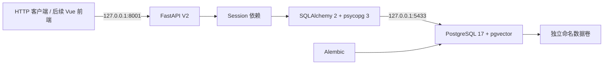

# V2 后端基础架构

## 范围和边界

V2 是模块化单体：后续 Vue 3/Vite 前端通过 `/api/v2` 调用独立 FastAPI 后端；
SQLAlchemy 2 连接 PostgreSQL 17，Alembic 管理数据库版本，pgvector 提供后续向量存储能力。
当前已完成基础表、数据库连接、健康检查以及 Cookie 数据库会话认证、CSRF 和角色权限依赖。
注册、登录、退出及当前用户接口已实现；3A 已增加知识库元数据 CRUD 与资源所有权隔离。3B-1 已增加原始文件上传和管理；3B-2A 已增加受限解析与 Chunk；3B-2B 已增加可选 Embedding、pgvector 精确检索和独立索引 Worker；3C-1 已增加有界 BM25、Dense 和 RRF 检索 HTTP 接口，问答接口尚未开发。

V1 `backend/main.py`、RAG、知识库、前端、原始测试和 `.venv` 均保持独立。
V2 不导入 V1 模块、不读取根 `.env`、不初始化 V1 RAG；默认不调用外部模型 API，云处理需要独立 V2 配置和显式同意。
V1 使用原有启动方法及 8000 端口，V2 默认仅监听 `127.0.0.1:8001`。

## 模块

| 路径 | 职责 |
| --- | --- |
| `backend/v2/main.py` | 应用工厂、生命周期、通用错误响应 |
| `core/` | `DS_V2_` 配置和基础日志 |
| `db/` | 独立 ORM Base、连接池、Session 工厂 |
| `models/` | 持久化模型及数据库约束 |
| `schemas/` | 对外响应结构，避免直接序列化凭证模型 |
| `dependencies/` | 每请求 Session、当前身份、激活状态和角色权限依赖 |
| `routers/` | HTTP 边界与健康检查 |
| `services/` | 认证与后续应用用例服务 |
| `migrations/` | 可审查的 schema 版本历史 |
| `tests/` | API 单元测试和隔离 PostgreSQL 集成测试 |
| `deploy/v2/` | 本地数据库、随机凭证初始化 |

## 运行策略

- 同步 SQLAlchemy + psycopg 3，健康检查为同步路由，由 FastAPI 在线程池执行，避免阻塞事件循环。
- 连接池启用 `pool_pre_ping`；连接超时 3 秒、SQL 语句超时 5 秒。
- Session 随请求关闭，未提交事务回滚；业务服务未来需显式定义提交边界。
- 引擎随应用生命周期创建和释放。应用启动不自动执行迁移，也不调用 `create_all()`。
- 存活检查与数据库检查分开，数据库断连不妨碍进程存活检查。
- 日志不主动记录配置、DSN、SQL 参数或驱动异常正文；HTTP 异常不返回堆栈。

## 配置和安全

配置来源为 `deploy/v2/.env`，进程中同名 `DS_V2_` 环境变量优先。
密码为 Pydantic `SecretStr`，连接地址使用 SQLAlchemy `URL.create()` 处理特殊字符。
本地 `.env` 被 Git 忽略，初始化脚本使用独占创建和 0600 权限，重复运行不覆盖。
没有 CORS 通配符；前端来源必须显式配置，带凭证请求同时校验 Origin 和 Cookie 绑定 CSRF。
密码使用 Argon2id；会话仅存摘要；登录失败限流使用 PostgreSQL 事务行锁跨进程生效。
默认要求 HTTPS/Secure Cookie，本地 HTTP 需要明确启用 loopback 开发模式。

数据库镜像固定到已验证的多架构 digest，并选择 `linux/arm64`。
开发容器中的 `POSTGRES_USER` 是初始化管理账户，拥有迁移和创建测试库权限，
**不能直接作为生产运行账户**。生产阶段需分离迁移账户和最小权限应用账户，并增加备份、TLS 和密钥管理。
Docker 管理权限的本机用户可以查看容器环境变量；当前配置用于本机开发，不是生产 secrets 方案。

## 后续扩展

后续按业务模块扩展 routers/services/models，所有业务实体继续使用 UUID。
RAG V1 未来通过服务适配层接入；V2 检索服务独立实现，不改变 V1 算法或生成逻辑。
文档解析 Worker 已按下节 3B-2A 实现；视觉模型、对象存储和外部任务队列仍不在范围内。

参考：[SQLAlchemy 引擎配置](https://docs.sqlalchemy.org/en/20/core/engines.html)、
[FastAPI 生命周期](https://fastapi.tiangolo.com/advanced/events/)、
[Alembic 教程](https://alembic.sqlalchemy.org/en/latest/tutorial.html)。

## 第三阶段 3A：知识库元数据与隔离

本阶段新增 knowledge_bases 模型和服务，仍为模块化单体，不新增微服务或依赖。
接口依赖原有 require_active_user，身份来自数据库会话；所有写操作复用原有 Origin/CSRF 校验。
V2 CORS 增加 PATCH、DELETE 方法，来源白名单保持不变；知识库响应使用 no-store，避免私人元数据被共享缓存。

| 资源 | 读取 | 修改/删除 |
| --- | --- | --- |
| 自己的有效私人知识库 | 当前所有者 | 当前所有者 |
| 其他用户私人知识库 | 404，管理员也不例外 | 404，管理员也不例外 |
| 有效公共知识库 | 所有已登录激活用户 | 管理员 |
| 已软删除知识库 | 404 | 404 |

普通创建入口始终把 owner_id 设置为当前用户、visibility 设置为 private。
公共创建只有管理员专用入口，owner_id 固定 NULL；请求不能覆盖 owner、可见性或索引版本。
没有“管理员可读全部私人资料”的隐式特权。

services/knowledge_base_service.py 集中实现 readable_scope、get_readable、get_writable、
require_public_manager。范围过滤发生在 SQL 中，不先取出其他人的记录再交给路由过滤。
修改/删除在检查权限时获取行锁，CRUD 服务负责提交事务；唯一性冲突回滚完整操作。
访问检查助手不提交事务，后续文档服务可在自己的事务内复用检查。

删除采用 tombstone，所有面向业务的列表、详情和修改检查一致排除 deleted_at 非空记录。
数据库唯一索引仅覆盖有效记录，允许删除后重建同名资源，新记录使用新 UUID。
数据库没有启用 RLS；应用和未来 Worker 必须复用服务层访问检查，不能直接暴露任意 ORM 查询。

3A 的 documents/chunks 关系预留（documents 已在下节 3B-1 落实）：先检查所属知识库的可读/可写权限，再读取内容；
软删除后不得继续返回其文档、片段或检索结果。index_version 初始为 0，只由未来索引服务推进。
3A 当时没有文件；本轮 3B-1 仍不实现解析、Embedding、向量检索或 RAG 改动。

## 3B-1：原始文件与授权边界

新增 documents 元数据与本机私有存储，仍为模块化单体，不增加对象存储或 Worker。
上传 POST 在认证、Origin/CSRF、get_writable、配额检查后才解析 multipart。
每次仅允许名为 file 的单个文件，不接受其他表单字段；状态固定 uploaded，表示尚未解析/索引。
文件名只用于展示及安全附件响应，永不参与磁盘路径拼接。

- services/file_storage.py 提供 save/open/remove 的本地实现，后续存储替换保持该服务边界。
- services/file_validation.py 做有界格式/容器结构检查，不抽取文档正文、不落地解压 Office 文件。
- services/document_service.py 统一调用知识库授权助手，文档必须同时匹配 doc_id 与 kb_id。
- 读取及写入锁父知识库行，避免与知识库软删除交错。上传持锁直至文件与元数据处理完成。
- 下载在授权锁内打开 O_NOFOLLOW 文件描述符，再释放事务；已经打开的流可以完成，后续新请求不可绕过墓碑。
- 私人资源非所有者始终 404，管理员无特权；公共文件所有激活用户可读，仅管理员可上传/删除。

存储默认位于 ~/Library/Application Support/AI-DataStructure-Assistant/v2/files，可配置为仓库外绝对路径。
应用按目录描述符逐层打开，拒绝符号链接和路径中的 ..；私有根目录要求服务用户所有、0700。
文件随机 256-bit 标识、0600、临时文件写入/校验/fsync 后原子重命名。没有公开静态挂载。
数据库写入失败会回滚并补偿删除本次对象；文件写入失败不会留下元数据。
删除先提交墓碑，再删文件和更新 storage_deleted_at。清理失败保持不可见，重复 DELETE 可重试。
父知识库软删除立即屏蔽文档，但保留文件和元数据，不自动执行物理级联。

本机首版每个部署数据库通过 PostgreSQL 事务 advisory lock 仅允许一个上传进入解析/存储阶段，
跨进程生效；同一知识库通过行锁串行化配额与删除检查。默认 20 MiB/文件、100 文件/知识库、
1 GiB/知识库、10 GiB/数据库，未完成物理清理的墓碑仍计费。全局锁繁忙返回 429。
请求实际接收最多单文件上限 + 64 KiB multipart 开销，解析超时默认 120 秒；实际文件另按 64 KiB 流读取限额。

未来 Worker 不得直接信任队列中的 document/storage_key：在有授权的事务中调用
get_document(session, user, kb_id, doc_id)，再经 open_download 的相同父资源授权边界打开对象。
Worker 的任务身份、状态机和索引提交尚未设计；不得用数据库管理员身份当作学生资料读取授权。
后续检索须先限定 readable_scope，再校验 document.deleted_at 与父知识库状态。

## 3B-2A：受限文档解析与 PostgreSQL 任务

上传保存原文件后，在同一个元数据事务中插入 ingestion_jobs；插入任务失败会回滚文档并补偿清理对象。
API 不在 lifespan 中启动 Worker。独立 python -m backend.v2.worker 进程按 PostgreSQL 队列轮询，
支持多个进程；不引入 Celery/Redis，也不创建 embedding/向量表。

### 授权和事务顺序

所有变更按 knowledge_base → document → ingestion_job 锁顺序，避免与现有上传/删除形成反向锁依赖。
领取候选使用父知识库 FOR UPDATE SKIP LOCKED；锁定后重新检查最新任务状态与到期时间。
Worker 使用任务 requested_by 对应的真实用户，调用现有 get_writable，校验激活、私人所有权及公共管理员权限。
领取、打开原文件和提交结果均重新检查权限、父/文档墓碑、解析代次与租约；不以数据库管理权限代替授权。
文件仍由 LocalFileStorage 打开，O_NOFOLLOW、大小和 SHA-256 均检查；不重新实现文件存储。

租约 token 为每次领取新 UUID，attempts 原子递增；提交必须同时匹配任务、token、generation、有效期。
同一知识库的短事务串行化，不在解析期间持有数据库行锁。默认解析最长 30 秒，租约 90 秒，
配置要求至少额外 15 秒供启动/入库；无需在解析中续租。到期结果永不发布，过期 running 可被重新领取。

每个文档仅保留一条当前任务记录。显式重试或重新解析增加 document.ingestion_version，
重复在途 POST 不重置租约或重试预算。旧 Chunk 在新任务期间不对外返回；成功时同一事务替换全部行、
更新 parsed_version、文档 parsed 和任务 succeeded，避免新旧混用及部分入库。
ready 仅为未来向量索引完成保留，本轮不会写 ready。

### 隔离边界

解析器通过 -I -B 独立 Python 子进程运行，显式 namespace 加载 V2 代码，不读取仓库根目录包或 .env。
子进程环境仅含必要 PATH/LANG，不继承数据库密码、DS_V2_* 或 Python loader 环境；不记录子进程 stderr。
在当前 macOS 使用系统 sandbox-exec：拒绝网络、fork、非白名单执行、输入/运行库/V2 代码以外文件内容读取，
写入仅允许本轮 0600 结果文件及 /dev/null。结果目录 0700，finally 清理；输入是已有安全文件描述符。
沙箱不可用时任务失败 isolation_unavailable，不会回退为无沙箱解析。

子进程设置 CPU、输出文件大小、打开文件数及禁止 core dump，并设置 alarm，避免父进程被 SIGKILL 后子进程永久存活。
父进程每 50 ms 检查墙钟时间和 RSS（psutil），超限直接 kill 并 wait。macOS 此 Python 构建不可靠支持
RLIMIT_DATA/AS，因此没有宣称地址空间硬上限：RSS 看门狗有采样窗口和瞬时超限风险，生产仍需 OS/容器内存预算。
沙箱不是 VM，也不是对内核或所有本机 IPC 的隔离；不应把本机开发安全边界当作完整恶意代码执行平台。

### 提取和 Chunk

pypdf 6.21.2：只提取文本层并保留 1-based PDF 页码；加密 PDF 拒绝，无 OCR，无文字失败 no_text。
python-docx 1.2.0/lxml 6.1.3：按正文顺序提取段落、标题、列表、表格和可获取的 OMML 公式文本；
不启动 Word/LibreOffice、宏或脚本，不主动请求外部链接。DOCX 复用上传 ZIP 检查，再按实际解压长度/CRC
验证全部条目（最多 256、单项 32 MiB、累计 64 MiB、比例 200），拒绝 XML DTD/ENTITY 后才交给解析库。
TXT 采用严格 UTF-8/BOM；保留 Markdown 标题、列表、围栏代码和公式文本。

chunking.py 是独立、确定性纯模块：先按页/章节分组，再按自然段打包；短代码围栏和 $$ 公式尽量整体保留，
超长块以字符长度兜底，重叠用于同组可容纳的相邻块/长段落。页和章节之间不拼接重叠。
源信息保存页码、标题、源 block 范围和代次；每个 Chunk 有稳定顺序与 SHA-256。字符切分不是 grapheme/token 切分。

### 恢复

上传任务原子创建；每轮 Worker 对有效 uploaded/processing 但缺任务的文件做最多 100 条对账，兼容 0004 遗留数据。
解析完成但尚未提交时崩溃，租约到期重做；提交中失败整体回滚。临时存储故障按指数退避、最多默认 3 次；
数据库断连时保留租约，由恢复者重试。格式损坏、扫描件无文字、页/字数/Chunk/时间/内存超限不会自动盲目重试。
SIGTERM/SIGINT 设置停止标志，终止当前解析子进程并将有效任务延后重试；SIGKILL 依靠实际租约恢复。
父/文档删除或执行身份失效时取消任务，不提交 Chunk；已有 Chunk 墓碑下仍物理保留但所有业务读取立即拒绝。

## 3B-2B：Embedding、缓存与原子发布

新增 V2 Provider 协议及 DashScope/确定性测试实现；不导入 V1 RAG，不读取根 .env，不在 API 启动时初始化远程模型。
解析和向量化是两类任务：共用 task_leases.py 的候选 SKIP LOCKED、KB→document→job 锁顺序、授权和租约终结函数，
使用独立 embedding_jobs/Worker，不让索引失败覆盖解析结果。默认 provider=disabled，解析仍停止于 parsed。

向量空间 embedding_spaces 以 provider、模型名、显式发布 revision、维度、端点及归一化策略生成 SHA-256 标识。
测试模型固定标记 deterministic-sha256-v1，与真实云模型永不共用空间。当前物理 schema 是 vector(1024)，
其他维度配置失败关闭，需后续 migration/新空间，不自动把旧列当成新维度。

云端必须同时具备 provider=dashscope、cloud_enabled、V2 独立 Key、非 unverified 的模型 revision，
以及当前文档 ingestion_version 的明确 allow_cloud=true 同意。重新解析后同意不继承。
Worker 首次向新空间发送个人文档前，先用合成文本分别验证 document/query 模式及真实响应维度；失败不发送文档。
这只是模型可用性/返回结构探测，不是模型权重版本认证。提供商别名可能静默升级，部署者必须维护明确 revision/停旧 Worker。

状态 uploaded → processing → parsed → indexing → ready；解析失败为 failed，索引失败为 index_failed，保留可读 Chunk。
成功解析可在同一事务补索引任务（仅在 provider 启用且同意满足时）；索引 Worker 另对旧 parsed/旧空间 ready 文件做有界对账。
队列满时解析成功不回滚，后续对账再补任务。默认最多 1000 个 queued/running 索引任务。

索引任务绑定解析 generation、index_revision、当前 Chunk 清单哈希和数量，按批获取原文后结束数据库事务再调用 Provider。
每次可能收费的请求之前，在短事务中预占 api_calls、检查总预算/绝对任务截止时间，并续租；网络期间不持行锁或数据库事务。
跨进程并发使用 AUTOCOMMIT 连接上的会话 advisory slot，默认全数据库仅一个远程请求；连接释放/进程崩溃自动释放槽。
HTTP 使用 httpx2 原生 async I/O + asyncio 绝对时限，禁用环境代理和重定向，限制响应大小且拒绝压缩响应。

每批合法向量独立缓存，唯一键 chunk_id+space_id，复合 FK 绑定真实 Chunk ID/文档/代次/内容 hash。
Provider 和保存服务均验证数量、1024 维、有限数、非零范数并归一化；数据库再检查 vector_dims 和单位范数。
Chunk 哈希通过 PostgreSQL SHA-256 CHECK 对应实际正文，禁止改正文却保留旧 hash；引用向量存在时不能直接改 FK 目标。
重新解析替换 Chunk 时通过 FK CASCADE 移除旧缓存，不对原始文件/知识库做物理级联删除。

分批缓存没有发布资格。最终事务重新授权、验墓碑/租约/空间/两种代次/完整 Chunk 清单，确认全部向量存在才原子写 ready。
崩溃恢复复用已经提交的同空间同 hash 缓存；过期 Worker 即使得到 API 响应也不能写缓存或发布。
模型切换先取消同文档旧空间任务，配置空间过滤使旧向量立即无检索资格，再重建目标空间。
应停旧 Worker 后统一部署新配置，避免不同配置的 Worker 互相抢占文档索引目标。

vector_search.py 仅提供内部服务：先重新校验数据库用户激活和请求 KB 可读权限，再 SQL 关联四类资源与空间/成功任务。
SQL 同时过滤 KB 所有权/墓碑、文档墓碑/ready/当前代次、Chunk hash、空间和全量向量数量；授权集合使用 MATERIALIZED CTE，
然后才做精确 cosine_distance 排序。管理员没有私人资料越权。相似度=1-余弦距离，不能直接套用 V1 阈值。
不创建 HNSW/IVFFlat，不提供聊天或公开搜索接口；未来近似索引需先评测召回及权限行为。

## 3C-1：多用户 Hybrid 检索

入口 `POST /api/v2/retrieval/search` 使用当前 Cookie 身份和既有 Origin/CSRF 检查；请求不接受 user_id。
`retrieval_service.search` 统一处理 bm25/dense/hybrid 三种模式，不生成回答、不做 Reranking 或查询扩展。
Dense 直接调用既有 `embed_query`/`exact_search`；BM25 与 Dense 共用 `vector_search.eligible_chunks` 的
MATERIALIZED 授权集合：选定 KB、当前用户可读范围、KB/文件墓碑、ready、当前解析/索引代次、空间、Chunk hash、
succeeded 索引任务和全量向量数量校验。三种模式均不纳入 parsed/indexing/index_failed 文档。

没有私人语料缓存。BM25 在每请求的有限授权快照内计算 Okapi 分数，k1=1.5、b=0.75；
NFKC/casefold 后保护英文代码标识符和数字，以 jieba 处理中文；B 树/B-tree 统一为 btree，保留红黑树、AVL、Dijkstra 等术语。
只共享不含用户文本的分词词典；不导入 V1 模块或固定 JSONL。
BM25 仅正分候选参与排序；查询去重词项，空/纯停用词查询返回空。英文/中文停用词是小型明确列表，不是完整语言分析器。

每路最多 max(candidate_k,top_k) 个候选；RRF = Σ weight/(rrf_k+rank)，rank 从 1 开始，默认 20/60/1/1。
按稳定 Chunk UUID 去重和打破同分；不混加 BM25、余弦和 RRF 原始分数，不使用 V1 的 0.58 阈值。
单路模式的 fused_score 为 null。Dense 不可用时，dense/hybrid 返回明确错误，不自动降级；bm25 必须由调用方明确选择。

### 查询期间的一致性与边界

先在短 Session 内授权全部 KB，再在无行锁/事务的条件下生成查询向量；云查询另外要求 allow_cloud=true，默认关闭。
网络返回后使用新的 Session 锁定并刷新当前 User，再按 UUID 顺序对全部 KB 加 FOR SHARE，重新验证认证会话和完整授权范围。
现有删除、解析、索引及文件变更都先取得 KB FOR UPDATE，故会与该读锁互斥。
授权快照内完成语料限额检查、BM25、Dense 和响应数据复制，结束事务才返回；不在外部 API 请求期间持有资源锁。
若权限变化在锁前已提交则拒绝/排除；若发生在读快照后则等待读事务结束，属于快照之后的变更。
不能召回已经返回到客户端的内容，也不承诺网络传输期间任意时刻的撤回。绕过应用直接写数据库不属于此锁协议。
混合范围包含任意未知/无权 KB，整个请求返回统一 404，不悄悄缩小范围。

跨进程 PostgreSQL advisory slots 默认限制同时 2 个检索；无空位返回 429，不无限排队。
SQL 先截取最多 max_corpus_chunks+1 个授权候选，超出限制返回 413，不用截断语料计算有偏 IDF。
默认 2000 Chunk、4 MiB UTF-8 正文、200000 分词 Token；分别在载入正文前和建立 Counter 时检查。
不把向量数组载入 Python。默认查询 512 字符、top_k 最大 20，候选配置最大 100。
这些是有界输入/并发内存控制，不是 OS RSS 硬隔离；公共 jieba 词典也占固定内存。
SQL 沿用 5 秒 statement_timeout。大量分词和精确向量排序仍需压测。

未来扩大规模时应引入按 KB/代次维护的持久化词项统计或独立检索索引，避免逐请求重新分词及相关子查询；
任何索引缓存仍须绑定空间/代次并在命中时重新授权。HNSW、BM25 持久化、语义质量评测和租户每日费用限制尚未实现。
