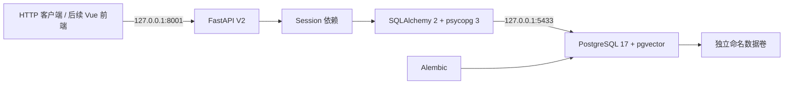

# V2 后端基础架构

## 范围和边界

V2 是模块化单体：后续 Vue 3/Vite 前端通过 `/api/v2` 调用独立 FastAPI 后端；
SQLAlchemy 2 连接 PostgreSQL 17，Alembic 管理数据库版本，pgvector 提供后续向量存储能力。
当前已完成基础表、数据库连接、健康检查以及 Cookie 数据库会话认证、CSRF 和角色权限依赖。
注册、登录、退出及当前用户接口已实现；3A 已增加知识库元数据 CRUD 与资源所有权隔离。文件上传和问答接口尚未开发。

V1 `backend/main.py`、RAG、知识库、前端、原始测试和 `.venv` 均保持独立。
V2 不导入 V1 模块、不读取根 `.env`、不初始化 RAG、不调用任何外部模型 API。
V1 使用原有启动方法及 8000 端口，V2 默认仅监听 `127.0.0.1:8001`。

## 模块

| 路径 | 职责 |
| --- | --- |
| `backend/v2/main.py` | 应用工厂、生命周期、通用错误响应 |
| `core/` | `DS_V2_` 配置和基础日志 |
| `db/` | 独立 ORM Base、连接池、Session 工厂 |
| `models/` | 持久化模型及数据库约束 |
| `schemas/` | 对外响应结构，避免直接序列化凭证模型 |
| `dependencies/` | 每请求 Session、当前身份、激活状态和角色权限依赖 |
| `routers/` | HTTP 边界与健康检查 |
| `services/` | 认证与后续应用用例服务 |
| `migrations/` | 可审查的 schema 版本历史 |
| `tests/` | API 单元测试和隔离 PostgreSQL 集成测试 |
| `deploy/v2/` | 本地数据库、随机凭证初始化 |

## 运行策略

- 同步 SQLAlchemy + psycopg 3，健康检查为同步路由，由 FastAPI 在线程池执行，避免阻塞事件循环。
- 连接池启用 `pool_pre_ping`；连接超时 3 秒、SQL 语句超时 5 秒。
- Session 随请求关闭，未提交事务回滚；业务服务未来需显式定义提交边界。
- 引擎随应用生命周期创建和释放。应用启动不自动执行迁移，也不调用 `create_all()`。
- 存活检查与数据库检查分开，数据库断连不妨碍进程存活检查。
- 日志不主动记录配置、DSN、SQL 参数或驱动异常正文；HTTP 异常不返回堆栈。

## 配置和安全

配置来源为 `deploy/v2/.env`，进程中同名 `DS_V2_` 环境变量优先。
密码为 Pydantic `SecretStr`，连接地址使用 SQLAlchemy `URL.create()` 处理特殊字符。
本地 `.env` 被 Git 忽略，初始化脚本使用独占创建和 0600 权限，重复运行不覆盖。
没有 CORS 通配符；前端来源必须显式配置，带凭证请求同时校验 Origin 和 Cookie 绑定 CSRF。
密码使用 Argon2id；会话仅存摘要；登录失败限流使用 PostgreSQL 事务行锁跨进程生效。
默认要求 HTTPS/Secure Cookie，本地 HTTP 需要明确启用 loopback 开发模式。

数据库镜像固定到已验证的多架构 digest，并选择 `linux/arm64`。
开发容器中的 `POSTGRES_USER` 是初始化管理账户，拥有迁移和创建测试库权限，
**不能直接作为生产运行账户**。生产阶段需分离迁移账户和最小权限应用账户，并增加备份、TLS 和密钥管理。
Docker 管理权限的本机用户可以查看容器环境变量；当前配置用于本机开发，不是生产 secrets 方案。

## 后续扩展

后续按业务模块扩展 routers/services/models，所有业务实体继续使用 UUID。
RAG V1 未来通过服务适配层接入；本阶段不改变检索算法或生成逻辑。
文档解析和视觉模型 Worker、对象存储、任务队列等需要独立设计后接入，不在本阶段新增服务。

参考：[SQLAlchemy 引擎配置](https://docs.sqlalchemy.org/en/20/core/engines.html)、
[FastAPI 生命周期](https://fastapi.tiangolo.com/advanced/events/)、
[Alembic 教程](https://alembic.sqlalchemy.org/en/latest/tutorial.html)。

## 第三阶段 3A：知识库元数据与隔离

本阶段新增 knowledge_bases 模型和服务，仍为模块化单体，不新增微服务或依赖。
接口依赖原有 require_active_user，身份来自数据库会话；所有写操作复用原有 Origin/CSRF 校验。
V2 CORS 增加 PATCH、DELETE 方法，来源白名单保持不变；知识库响应使用 no-store，避免私人元数据被共享缓存。

| 资源 | 读取 | 修改/删除 |
| --- | --- | --- |
| 自己的有效私人知识库 | 当前所有者 | 当前所有者 |
| 其他用户私人知识库 | 404，管理员也不例外 | 404，管理员也不例外 |
| 有效公共知识库 | 所有已登录激活用户 | 管理员 |
| 已软删除知识库 | 404 | 404 |

普通创建入口始终把 owner_id 设置为当前用户、visibility 设置为 private。
公共创建只有管理员专用入口，owner_id 固定 NULL；请求不能覆盖 owner、可见性或索引版本。
没有“管理员可读全部私人资料”的隐式特权。

services/knowledge_base_service.py 集中实现 readable_scope、get_readable、get_writable、
require_public_manager。范围过滤发生在 SQL 中，不先取出其他人的记录再交给路由过滤。
修改/删除在检查权限时获取行锁，CRUD 服务负责提交事务；唯一性冲突回滚完整操作。
访问检查助手不提交事务，后续文档服务可在自己的事务内复用检查。

删除采用 tombstone，所有面向业务的列表、详情和修改检查一致排除 deleted_at 非空记录。
数据库唯一索引仅覆盖有效记录，允许删除后重建同名资源，新记录使用新 UUID。
数据库没有启用 RLS；应用和未来 Worker 必须复用服务层访问检查，不能直接暴露任意 ORM 查询。

后续 documents/chunks 只预留关系设计：先检查所属知识库的可读/可写权限，再读取内容；
软删除后不得继续返回其文档、片段或检索结果。index_version 初始为 0，只由未来索引服务推进。
本轮没有文件、解析、Embedding、向量检索或 RAG 改动。
