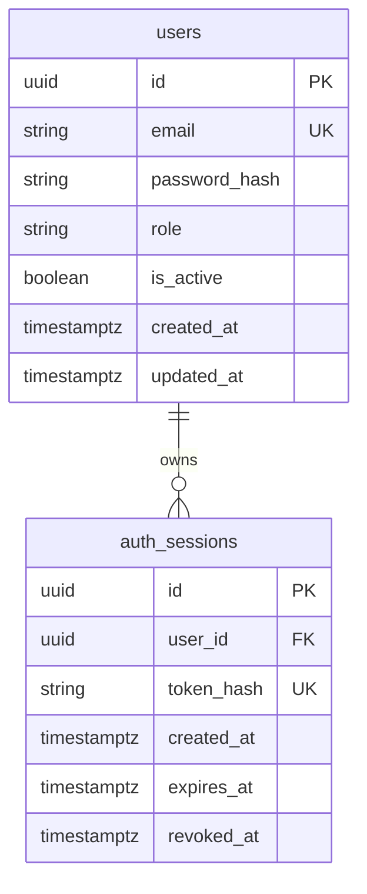

> 当前集成交付版本：2026-10-26，Alembic **0007_cloud_consents**，Generator **qwen3.8-flash**。当前启动、用途授权与API以 TEAM_ONBOARDING.md、FRONTEND_HANDOFF.md、openapi.json 及本文“最终集成”章节为准。以下旧阶段验收（0006、NOT VERIFIED、云生成硬阻塞）是历史记录，不代表当前状态。

# V2 数据库模型

数据库：PostgreSQL 17；扩展：pgvector；编码 UTF-8。
迁移链：`0001_auth_foundation` → `0002_login_limits` → `0003_knowledge_bases` → `0004_documents` → `0005_document_ingestion` → `0006_chunk_embeddings`（当前 head）。既有 0001–0005 保持原样。
所有 UUID 由数据库 `gen_random_uuid()` 生成，不依赖整数自增序列。
时间列均为 `timestamptz`，应用使用带时区时间，建议统一 UTC。

## users

| 字段 | 类型 | 约束 / 默认值 |
| --- | --- | --- |
| id | uuid | 主键，数据库随机 UUID |
| email | varchar(320) | 必填，非空白，`lower(email)` 唯一索引 |
| password_hash | text | 必填、非空；Argon2id 编码，含随机盐和参数 |
| role | varchar(16) | 必填，默认 `student`；仅 `student`、`admin` |
| is_active | boolean | 必填，默认 true |
| created_at | timestamptz | 必填，默认 `now()` |
| updated_at | timestamptz | 必填，默认 `now()`；SQLAlchemy UPDATE 自动更新 |

`updated_at` 采用 ORM `onupdate=now()`，不是数据库触发器。
直接执行原生 SQL 更新时调用方必须显式更新此字段。
邮箱唯一索引忽略大小写；注册/登录在应用层校验格式、去首尾空白、casefold。
密码使用 pwdlib Argon2id（64 MiB、3 次迭代、并行度 1），校验后按需重新哈希。
没有默认管理员；公开注册强制 student，管理员仅通过本地交互管理命令显式创建。

## auth_sessions

| 字段 | 类型 | 约束 / 默认值 |
| --- | --- | --- |
| id | uuid | 主键，数据库随机 UUID |
| user_id | uuid | 必填，外键引用 users.id，ON DELETE CASCADE |
| token_hash | varchar(64) | 必填、唯一、64 位小写十六进制 SHA-256 摘要 |
| created_at | timestamptz | 必填，默认 `now()` |
| expires_at | timestamptz | 必填，必须晚于 created_at |
| revoked_at | timestamptz | 可空，非空时不得早于 created_at |

索引：`ix_auth_sessions_user_id`、`ix_auth_sessions_expires_at`，以及 token_hash 唯一索引。
会话仅保存随机高熵 token 的摘要，不能保存明文 token。
SHA-256 约定用于随机会话 token，**不能用于用户密码哈希**。
令牌使用 32 字节安全随机数生成，仅以 HttpOnly Cookie 发送给浏览器；库中只有摘要。
认证请求检查数据库到期时间、revoked_at 和用户激活状态。
退出只更新当前会话的 revoked_at，不删除或吊销该用户其他会话。
会话绑定的 CSRF Token 使用 Cookie 密钥派生，无需在表中新增字段。

## auth_login_limits（0002 新增）

| 字段 | 类型 | 约束 / 默认值 |
| --- | --- | --- |
| key | varchar(64) | 主键，命名空间化邮箱或客户端 IP 的 SHA-256 摘要 |
| window_started_at | timestamptz | 必填，默认 now() |
| failures | integer | 必填，默认 0，CHECK failures >= 0 |

一次登录按固定键顺序插入/锁定邮箱和 IP 两个计数桶，使用 PostgreSQL `ON CONFLICT` 和
`SELECT FOR UPDATE`，窗口时间取数据库 clock_timestamp()，密码校验期间持锁。
失败计数在返回 401 前提交；达到限制返回 429，不执行昂贵的密码校验。
成功登录清零邮箱桶，不清零 IP 桶，防止用成功账户绕过 IP 失败限制。
窗口过期时在锁内重置，应用重启或多 worker 不会丢失计数。

默认每邮箱 15 分钟 5 次失败，每 IP 15 分钟 20 次失败，可配置。
摘要避免直接保存邮箱/IP 文本，但不是匿名化，低熵输入仍可被字典猜测。
限流记录、过期会话的定时清理尚未自动化；需要在后续运维任务中按保留策略处理，不能批量清空表。
当前固定窗口允许窗口边界突发，也存在针对邮箱的短期锁定风险；不能替代边缘网关的全局防滥用。

密码参数参考 [OWASP Password Storage](https://cheatsheetseries.owasp.org/cheatsheets/Password_Storage_Cheat_Sheet.html)。
CSRF 设计参考 [OWASP CSRF Prevention](https://cheatsheetseries.owasp.org/cheatsheets/Cross-Site_Request_Forgery_Prevention_Cheat_Sheet.html)。

## 迁移约定

- schema 变更只能新增 Alembic revision；已交付迁移不要就地改写。
- `upgrade head` 首次创建扩展与表，重复执行不重建表、不清空数据。
- ORM metadata 不包含向量业务表，本阶段仅确认扩展可用。
- 初始 downgrade 会删除两张表，属于破坏数据操作；不能在有业务数据的库自动执行。
  downgrade 不删除 vector 扩展，以免影响后续模块。
- 集成测试新建随机命名数据库，先验证空库迁移，再插入数据、重复升级，最后只删除该测试库。
- 0002 只新增限流表，不删除或修改 users/auth_sessions；测试额外验证带旧数据从 0001 升级，重复升级保留数据。

## 第三阶段 3A：knowledge_bases

| 字段 | 类型 | 约束 / 默认值 |
| --- | --- | --- |
| id | uuid | 主键，gen_random_uuid() |
| owner_id | uuid，可空 | 外键 users.id，ON DELETE RESTRICT |
| name | varchar(120) | 非空；API 在规范化后校验 1–120 字符 |
| name_key | text | PostgreSQL STORED 生成列，不接受调用方赋值，不对外返回 |
| description | text | 必填，默认空字符串，最多 4000 字符 |
| visibility | varchar(7) | 必填，仅 private/public，默认 private |
| index_version | integer | 必填，默认 0，必须非负，API 只读 |
| created_at | timestamptz | 默认 now() |
| updated_at | timestamptz | 默认 now()，服务层修改/删除时更新 |
| deleted_at | timestamptz，可空 | NULL 表示有效，非 NULL 表示软删除 |

API 名称先做 Unicode NFKC、去首尾空白和合并连续空白，保留展示大小写。
数据库 name_key 由下面表达式生成，私有和公共命名统一使用这一数据库键：

    lower(btrim(regexp_replace(normalize(name, NFKC), '[[:space:]]+', ' ', 'g')))

大小写比较遵循当前 PostgreSQL lower/排序规则，而不是独立的 Python casefold。
生成列保证直接 SQL 也不能传入伪造名称键来绕过唯一性。

数据库 CHECK：
- visibility 仅为 private/public。
- private 必须 owner_id 非 NULL；public 必须 owner_id 为 NULL。
- name_key 长度大于 0，description 长度不超过 4000，index_version 非负。
- owner_id 外键保证私人知识库不能指向不存在的用户。

索引：
- ix_knowledge_bases_owner_id：所有 owner_id，支持所属资源和外键检查。
- ix_knowledge_bases_visibility：仅 deleted_at IS NULL 的可见性索引。
- uq_knowledge_bases_private_name：有效 private 的 (owner_id, name_key) 唯一。
- uq_knowledge_bases_public_name：有效 public 的 name_key 全局唯一。

不同用户可以有同名私人知识库，私人和公共属于不同命名空间。
并发唯一性由数据库约束保证，冲突映射为 409，不能仅依赖创建前查询。
公共创建权限由服务层和管理员依赖共同检查；数据库约束不代替调用者身份认证。

### 删除与未来关联清理

DELETE API 只写入 deleted_at/updated_at，不物理删除行；重复删除返回 404。
所有业务读取、列表和修改检查均排除墓碑，管理员也不能通过普通接口访问墓碑。
同名有效资源可重新创建，但旧 UUID 不恢复；当前没有恢复或物理清理接口。

users 外键为 RESTRICT，拥有私人知识库（含墓碑）的用户不能被直接物理删除，
避免账户删除产生脱离权限管理的资料。未来账户删除流程必须显式处理所属资源。

后续 documents 预期以 UUID 外键关联 knowledge_bases，chunks 关联 documents。
只有受控物理 purge 时才考虑 ON DELETE CASCADE 清理数据库子记录；软删除不会触发物理级联。
文件对象、解析任务和索引清理需独立的受控流程。3B-1 仅建立下述 documents，尚无解析任务/chunks 或 Worker。
后续内容查询必须先通过有效知识库的所有权检查，索引任务必须检查墓碑及 index_version。
初始版本 0 仅表示未建立内容索引，不是当前 CRUD 的乐观锁版本。

0003 仅新增表、约束和索引，不改动旧表/旧数据；迁移测试覆盖从 0002 升级及重复 upgrade。
生成列设计参考 [PostgreSQL 17 Generated Columns](https://www.postgresql.org/docs/17/ddl-generated-columns.html)。

## 3B-1：documents（0004）

|字段|类型|约束/语义|
|---|---|---|
|id|uuid|主键，gen_random_uuid()|
|knowledge_base_id|uuid|NOT NULL，knowledge_bases.id，ON DELETE RESTRICT|
|uploaded_by|uuid|NOT NULL，users.id，ON DELETE RESTRICT，由认证身份填写|
|original_filename|varchar(255)|NOT NULL，仅展示；API 另限制 UTF-8 字节数 <=255、禁止路径/控制字符|
|storage_key|varchar(64)|NOT NULL、UNIQUE、64 位小写十六进制随机标识，内部字段|
|mime_type|varchar(100)|NOT NULL，仅 PDF/DOCX/TXT 的三个 canonical MIME|
|size_bytes|bigint|NOT NULL、>0，流式实际计数|
|sha256|varchar(64)|NOT NULL、64 位小写十六进制内容摘要，不作去重唯一键|
|status|varchar(16)|NOT NULL，默认 uploaded；processing/parsed/failed 由处理服务更新，ready 为未来向量化完成预留|
|created_at/updated_at|timestamptz|NOT NULL，默认 now()，ORM/服务更新 updated_at|
|deleted_at|timestamptz|NULL 有效，非 NULL 即不可业务访问|
|storage_deleted_at|timestamptz|物理清理确认时间；非空必须已有 deleted_at，内部字段|

索引：ix_documents_kb_active（kb_id,created_at,id，过滤有效文档）、
ix_documents_kb_storage（kb_id，过滤未清理对象）、ix_documents_uploaded_by、
ix_documents_cleanup_pending（deleted_at，过滤墓碑且未确认清理），以及 storage_key 唯一约束。
允许同一知识库的同名、同内容或不同内容文件；每次上传均有独立 UUID 和随机对象。
不改已有知识库外键。物理删除父知识库或上传者受 RESTRICT 保护，须未来受控 purge 显式处理。

软删除文档不会删除元数据；重复 DELETE 对已授权且父知识库有效的同一记录返回 204 并重试清理。
父知识库墓碑屏蔽所有文档，但不自动设置每个文档墓碑、不物理删文件；这些保留对象仍纳入全局配额。
未来版本关系、解析任务和 chunks 应使用独立 UUID/FK，不以文件名或 storage_key 作为业务主键。
0004 只新增 documents；迁移测试覆盖从含既有用户/知识库的 0003 升级、重复升级及 schema check。

## 3B-2A：0005_document_ingestion

0005 扩展 documents.status 检查以容纳 parsed，新增 ingestion_version（正整数，默认 1）、parsed_version
（NULL 或等于 ingestion_version），增加有效文档 status/created_at 对账索引。既有文件/用户/知识库不删除、不重建。
不改写 0001–0004。仅新增版本中替换 documents status CHECK。

### document_chunks

|字段|类型/约束|
|---|---|
|id|UUID 主键，gen_random_uuid()|
|document_id|UUID NOT NULL，documents FK，RESTRICT|
|generation|正整数，必须与有效发布代次匹配（服务层）|
|chunk_index|非负整数，与 document_id 联合 UNIQUE，支持文档顺序查询|
|content|非空 text；受解析字符/Chunk 大小限制|
|content_hash|64 位小写十六进制 SHA-256|
|page_number|NULL 或正整数；PDF 的实际 1-based 页号|
|section_title|可空 varchar(300)|
|source_metadata|JSONB，默认 {}，服务层只写 block_start/block_end 非负整数|
|created_at|timestamptz，默认 now()|

没有 embedding 或向量列。API 同时要求父知识库有效、文档有效、status=parsed、
parsed_version=ingestion_version，且 Chunk generation 匹配。旧代次不会与新代次混用。
文档删除不物理级联删除 Chunk，后续受控 purge 必须显式处理 FK 和保留策略。

### ingestion_jobs

|字段|类型/语义|
|---|---|
|id|UUID 主键|
|document_id|UUID NOT NULL UNIQUE，documents FK RESTRICT，每文档一条当前任务|
|requested_by|UUID，users FK RESTRICT，Worker 执行时再次授权|
|generation|正整数，绑定文档解析代次|
|status|queued / running / succeeded / failed / cancelled|
|attempts / max_attempts|默认 0 / 3，0 <= attempts <= max_attempts，预算 1–10|
|created_at|默认 now()|
|started_at / finished_at|可空，最近一次运行开始/终结时间|
|next_retry_at|默认 now()，到期才可领取|
|lease_expires_at / lease_token|仅 running 必须非空；其他状态必须为空|
|error_code|可空，仅固定小写下划线安全码，不含文件内容、路径或驱动错误|

索引：status/next_retry_at/lease_expires_at 领取索引、requested_by 外键查询索引、document_id UNIQUE。
任务已用尽预算且租约到期时标记 failed/attempts_exhausted，不会无限循环。
文档状态 uploaded → processing → parsed 或 failed；任务状态 queued → running → succeeded/failed/cancelled，
可重试故障回 queued。任务取消不等同于文档物理删除；取消时文档置 failed，墓碑仍保持。
显式人工重试/重新解析复用任务 ID、增加 generation 并重置本代预算；当前没有完整任务历史审计表。

租约 token 与 generation 是提交 fencing 条件；旧 Worker 即便完成解析，也不能覆盖重新领取/新代次结果。
成功发布在一个事务中删除旧 Chunk、写新 Chunk、更新文档与任务。发布失败或 lease 过期则不留部分有效结果。

## 3B-2B：0006_chunk_embeddings

新增三表，不改写 0001–0005：

|表|字段/约束|
|---|---|
|embedding_spaces|id SHA-256 PK；provider、model、revision、dimension（CHECK=1024）、verified_at、created_at|
|chunk_embeddings|UUID PK；chunk_id/document_id/generation/chunk_content_hash 复合 FK→Chunk，ON DELETE CASCADE；space_id FK RESTRICT；embedding_dimension=1024；embedding vector(1024)；created_at|
|embedding_jobs|UUID PK；document_id、requested_by、space_id FK RESTRICT；UNIQUE(document_id,space_id)；generation、index_revision、manifest_hash、expected_chunks；status；attempts/max_attempts；api_calls/max_api_calls；started/finished/next_retry/deadline/lease；固定 error_code|

chunk_embeddings UNIQUE(chunk_id,space_id)，CHECK 维度和 abs(vector_norm-1)<0.001；pgvector 拒绝 NaN/Infinity。
B-tree 索引 document_id/space_id/generation 支持缓存和完整性检查，无近似向量索引。
Chunk 增加唯一引用键 (id,document_id,generation,content_hash) 及内容哈希 CHECK：
content_hash=encode(sha256(convert_to(content,'UTF8')),'hex')。不能将陈旧向量指向新正文或别的文档。

Documents 新增 embedding_space_id FK、indexed_version、index_revision（默认0，非负）、cloud_embedding_generation。
indexed_version 非空必须等于 ingestion_version。状态 CHECK 新增 indexing/index_failed；parsed_version 在索引失败时保留。
cloud_embedding_generation 是服务端同意快照，必须等于当前解析代次才允许云端处理/检索。

EmbeddingJob 的租约约束沿用 running 必须 token/expiry、非 running 必须为空；尝试预算 1–10，API 调用计数不超过快照预算。
索引代次和解析代次均须为正，expected_chunks>0，领取索引 status/next_retry_at/lease_expires_at。
第一次领取设置绝对 deadline_at，自动重试/崩溃恢复不重置 api_calls/deadline。人工对失败任务明确重试可新开索引代次预算，缓存继续复用。
每空间每文档保留一条当前任务，无完整历史审计。

ready 是当前空间与代次的全量原子发布，不是“存在一批缓存”。检索另联查 succeeded 任务、索引代次和当前完整 Chunk/向量数量，
即使数据库意外丢失部分缓存，也不会把残缺 ready 文档作为有效结果。未知人为数据破坏的自动修复不在本轮范围。
旧模型空间可保留用于受控回退/迁移；严禁仅改模型名字复用旧空间。改变物理维度需新迁移，不在线修改既有向量解释。

## 3C-1：检索读取约束（无新增迁移）

当前 head 保持 `0006_chunk_embeddings`；不新增 BM25 表、不改写 0001–0006。
关键词与向量统一联查 knowledge_bases、documents、document_chunks、chunk_embeddings、embedding_spaces 和 embedding_jobs。
只有匹配当前模型空间、当前 ingestion_version/parsed_version/indexed_version、有效 Chunk hash 和完成任务 index_revision 的
ready 文档有资格参与三种检索。Chunk 与有效向量计数须等于任务 expected_chunks，防止半成品进入 BM25 分支。

授权/墓碑过滤在候选排名之前完成。检索的 KB FOR SHARE 与现有写路径的 KB FOR UPDATE 互斥，
只覆盖有限本地计算事务，不跨云 API 请求。查询既不推进文档状态，也不改变知识库或索引代次。
BM25 IDF 基于此次明确选择且获授权的完整有限候选集，超限明确拒绝；无全局固定语料、全局私人词频或跨用户文本缓存。

## 3C-2A：证据版本与发布（无schema修改）

head继续为0006_chunk_embeddings，历史迁移不变，无新持久化表或云端结果缓存。
证据快照为Chunk UUID + content_hash + generation + document index_revision + embedding_space_id。
最终查询仍联查有效KB、ready文档、当前解析/索引代次、Chunk、向量空间和succeeded任务；管理员不豁免所有权。
最终短事务按User→AuthSession→KB的顺序取得共享锁；现有KB→document→job写路径与之互斥。
上下文不推进任务、不修改状态、不存储或发送生成答案；引用是一次请求内的标识，不是可绕过授权的永久下载地址。

## 3C-2B：回答发布与生成授权阻塞（无新迁移）

head继续0006_chunk_embeddings。新增RAG服务不持久化问题、答案或聊天历史，不修改业务表。
共用validate_evidence及User/AuthSession/KB共享锁复核整个生成输入快照，生成前后均匹配hash、generation、index_revision和embedding_space_id。
响应sources仅从仍有效的数据库Chunk及文档来源构造，不接受模型提供的文件名/页码/UUID。

当前无生成用途的持久化外发同意/撤销审计模型；Embedding文档代次同意不覆盖生成服务，Rerank请求同意也不自动继承。
本轮选择保持生产云端生成阻塞，不用单个HTTP布尔值冒充可审计授权。未来如启用，应通过新迁移建立最小用途、主体、资源版本、
模型/服务范围、时间、撤销和审计事件关联，并实现相应服务端验证；不得改写历史迁移或仅打开环境开关绕过。

## 最终集成：0007_cloud_consents（当前 head）

迁移链在0006之后新增0007；0001–0006保持原文件。只新增下列两张表和审计查询索引，不改写既有业务记录。

|表|字段与约束|
|---|---|
|cloud_consents|UUID主键；user_id/knowledge_base_id UUID外键RESTRICT；purpose CHECK embedding/reranking/generation；provider CHECK dashscope；model varchar128；service_key SHA256；granted_at timestamptz；revoked_at可空；UNIQUE(user_id,knowledge_base_id,purpose,service_key)|
|cloud_audits|UUID主键；user_id外键RESTRICT；purpose/service_key；event CHECK granted/revoked/attempt/succeeded/failed；details JSONB；created_at；(user_id,created_at)索引|

service_key覆盖purpose、provider、model、endpoint及Embedding revision，数据库中不保存端点/Key；授权范围为该用户/KB当前及未来版本。撤销不删除授权与审计，重新授予更新granted_at并清空revoked_at。旧服务指纹可保留历史，但不能满足新配置授权。文档当前代次cloud_embedding_generation仍作为额外门槛，不把Embedding授权扩大为Reranking或Generation。

审计仅安全元数据：调用随机关联ID、KB/文档/Chunk UUID、代次/hash、模型、固定事件、耗时和numeric usage，不保存问题、全文、答案、原始token、Key或完整URL。succeeded是一次传输上下文成功完成；响应格式/引用是否合法仍由Provider和RAG校验，不能据此统计事实质量。审计是应用追加约定，尚无数据库不可篡改策略、周期清理和完整保留政策。

开发库upgrade head、重复upgrade和Alembic check已实测；原有10张业务表行指纹不变，仅alembic_version推进到0007，两张新表在开发库为空。集成测试使用随机隔离库，授权数据/真实合成调用审计均在隔离库测试后清理，不把测试账号留在开发库。

当前document_chunks读取支持parsed、indexing、ready、index_failed中仍匹配parsed_version的当前代次；检索三模式要求ready及完整当前向量空间，不能把parsed课程导入当成可检索ready。0007不改变Chunk/Embedding发布语义。
