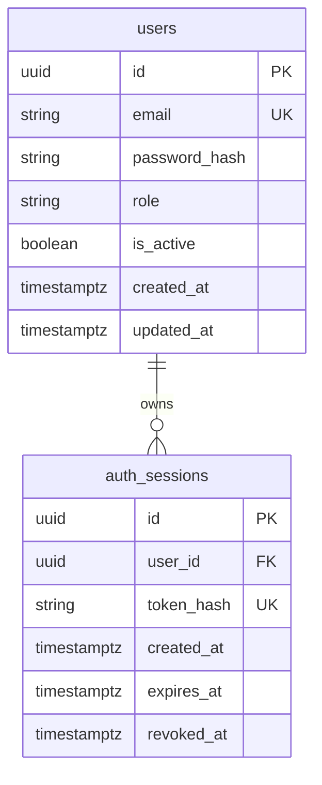

# V2 数据库模型

数据库：PostgreSQL 17；扩展：pgvector；编码 UTF-8。
迁移链：`0001_auth_foundation` → `0002_login_limits` → `0003_knowledge_bases`（当前 head）。既有 0001、0002 保持原样。
所有 UUID 由数据库 `gen_random_uuid()` 生成，不依赖整数自增序列。
时间列均为 `timestamptz`，应用使用带时区时间，建议统一 UTC。

## users

| 字段 | 类型 | 约束 / 默认值 |
| --- | --- | --- |
| id | uuid | 主键，数据库随机 UUID |
| email | varchar(320) | 必填，非空白，`lower(email)` 唯一索引 |
| password_hash | text | 必填、非空；Argon2id 编码，含随机盐和参数 |
| role | varchar(16) | 必填，默认 `student`；仅 `student`、`admin` |
| is_active | boolean | 必填，默认 true |
| created_at | timestamptz | 必填，默认 `now()` |
| updated_at | timestamptz | 必填，默认 `now()`；SQLAlchemy UPDATE 自动更新 |

`updated_at` 采用 ORM `onupdate=now()`，不是数据库触发器。
直接执行原生 SQL 更新时调用方必须显式更新此字段。
邮箱唯一索引忽略大小写；注册/登录在应用层校验格式、去首尾空白、casefold。
密码使用 pwdlib Argon2id（64 MiB、3 次迭代、并行度 1），校验后按需重新哈希。
没有默认管理员；公开注册强制 student，管理员仅通过本地交互管理命令显式创建。

## auth_sessions

| 字段 | 类型 | 约束 / 默认值 |
| --- | --- | --- |
| id | uuid | 主键，数据库随机 UUID |
| user_id | uuid | 必填，外键引用 users.id，ON DELETE CASCADE |
| token_hash | varchar(64) | 必填、唯一、64 位小写十六进制 SHA-256 摘要 |
| created_at | timestamptz | 必填，默认 `now()` |
| expires_at | timestamptz | 必填，必须晚于 created_at |
| revoked_at | timestamptz | 可空，非空时不得早于 created_at |

索引：`ix_auth_sessions_user_id`、`ix_auth_sessions_expires_at`，以及 token_hash 唯一索引。
会话仅保存随机高熵 token 的摘要，不能保存明文 token。
SHA-256 约定用于随机会话 token，**不能用于用户密码哈希**。
令牌使用 32 字节安全随机数生成，仅以 HttpOnly Cookie 发送给浏览器；库中只有摘要。
认证请求检查数据库到期时间、revoked_at 和用户激活状态。
退出只更新当前会话的 revoked_at，不删除或吊销该用户其他会话。
会话绑定的 CSRF Token 使用 Cookie 密钥派生，无需在表中新增字段。

## auth_login_limits（0002 新增）

| 字段 | 类型 | 约束 / 默认值 |
| --- | --- | --- |
| key | varchar(64) | 主键，命名空间化邮箱或客户端 IP 的 SHA-256 摘要 |
| window_started_at | timestamptz | 必填，默认 now() |
| failures | integer | 必填，默认 0，CHECK failures >= 0 |

一次登录按固定键顺序插入/锁定邮箱和 IP 两个计数桶，使用 PostgreSQL `ON CONFLICT` 和
`SELECT FOR UPDATE`，窗口时间取数据库 clock_timestamp()，密码校验期间持锁。
失败计数在返回 401 前提交；达到限制返回 429，不执行昂贵的密码校验。
成功登录清零邮箱桶，不清零 IP 桶，防止用成功账户绕过 IP 失败限制。
窗口过期时在锁内重置，应用重启或多 worker 不会丢失计数。

默认每邮箱 15 分钟 5 次失败，每 IP 15 分钟 20 次失败，可配置。
摘要避免直接保存邮箱/IP 文本，但不是匿名化，低熵输入仍可被字典猜测。
限流记录、过期会话的定时清理尚未自动化；需要在后续运维任务中按保留策略处理，不能批量清空表。
当前固定窗口允许窗口边界突发，也存在针对邮箱的短期锁定风险；不能替代边缘网关的全局防滥用。

密码参数参考 [OWASP Password Storage](https://cheatsheetseries.owasp.org/cheatsheets/Password_Storage_Cheat_Sheet.html)。
CSRF 设计参考 [OWASP CSRF Prevention](https://cheatsheetseries.owasp.org/cheatsheets/Cross-Site_Request_Forgery_Prevention_Cheat_Sheet.html)。

## 迁移约定

- schema 变更只能新增 Alembic revision；已交付迁移不要就地改写。
- `upgrade head` 首次创建扩展与表，重复执行不重建表、不清空数据。
- ORM metadata 不包含向量业务表，本阶段仅确认扩展可用。
- 初始 downgrade 会删除两张表，属于破坏数据操作；不能在有业务数据的库自动执行。
  downgrade 不删除 vector 扩展，以免影响后续模块。
- 集成测试新建随机命名数据库，先验证空库迁移，再插入数据、重复升级，最后只删除该测试库。
- 0002 只新增限流表，不删除或修改 users/auth_sessions；测试额外验证带旧数据从 0001 升级，重复升级保留数据。

## 第三阶段 3A：knowledge_bases

| 字段 | 类型 | 约束 / 默认值 |
| --- | --- | --- |
| id | uuid | 主键，gen_random_uuid() |
| owner_id | uuid，可空 | 外键 users.id，ON DELETE RESTRICT |
| name | varchar(120) | 非空；API 在规范化后校验 1–120 字符 |
| name_key | text | PostgreSQL STORED 生成列，不接受调用方赋值，不对外返回 |
| description | text | 必填，默认空字符串，最多 4000 字符 |
| visibility | varchar(7) | 必填，仅 private/public，默认 private |
| index_version | integer | 必填，默认 0，必须非负，API 只读 |
| created_at | timestamptz | 默认 now() |
| updated_at | timestamptz | 默认 now()，服务层修改/删除时更新 |
| deleted_at | timestamptz，可空 | NULL 表示有效，非 NULL 表示软删除 |

API 名称先做 Unicode NFKC、去首尾空白和合并连续空白，保留展示大小写。
数据库 name_key 由下面表达式生成，私有和公共命名统一使用这一数据库键：

    lower(btrim(regexp_replace(normalize(name, NFKC), '[[:space:]]+', ' ', 'g')))

大小写比较遵循当前 PostgreSQL lower/排序规则，而不是独立的 Python casefold。
生成列保证直接 SQL 也不能传入伪造名称键来绕过唯一性。

数据库 CHECK：
- visibility 仅为 private/public。
- private 必须 owner_id 非 NULL；public 必须 owner_id 为 NULL。
- name_key 长度大于 0，description 长度不超过 4000，index_version 非负。
- owner_id 外键保证私人知识库不能指向不存在的用户。

索引：
- ix_knowledge_bases_owner_id：所有 owner_id，支持所属资源和外键检查。
- ix_knowledge_bases_visibility：仅 deleted_at IS NULL 的可见性索引。
- uq_knowledge_bases_private_name：有效 private 的 (owner_id, name_key) 唯一。
- uq_knowledge_bases_public_name：有效 public 的 name_key 全局唯一。

不同用户可以有同名私人知识库，私人和公共属于不同命名空间。
并发唯一性由数据库约束保证，冲突映射为 409，不能仅依赖创建前查询。
公共创建权限由服务层和管理员依赖共同检查；数据库约束不代替调用者身份认证。

### 删除与未来关联清理

DELETE API 只写入 deleted_at/updated_at，不物理删除行；重复删除返回 404。
所有业务读取、列表和修改检查均排除墓碑，管理员也不能通过普通接口访问墓碑。
同名有效资源可重新创建，但旧 UUID 不恢复；当前没有恢复或物理清理接口。

users 外键为 RESTRICT，拥有私人知识库（含墓碑）的用户不能被直接物理删除，
避免账户删除产生脱离权限管理的资料。未来账户删除流程必须显式处理所属资源。

后续 documents 预期以 UUID 外键关联 knowledge_bases，chunks 关联 documents。
只有受控物理 purge 时才考虑 ON DELETE CASCADE 清理数据库子记录；软删除不会触发物理级联。
文件对象、解析任务和索引清理需独立的受控流程。本轮不创建这些表或 Worker。
后续内容查询必须先通过有效知识库的所有权检查，索引任务必须检查墓碑及 index_version。
初始版本 0 仅表示未建立内容索引，不是当前 CRUD 的乐观锁版本。

0003 仅新增表、约束和索引，不改动旧表/旧数据；迁移测试覆盖从 0002 升级及重复 upgrade。
生成列设计参考 [PostgreSQL 17 Generated Columns](https://www.postgresql.org/docs/17/ddl-generated-columns.html)。
