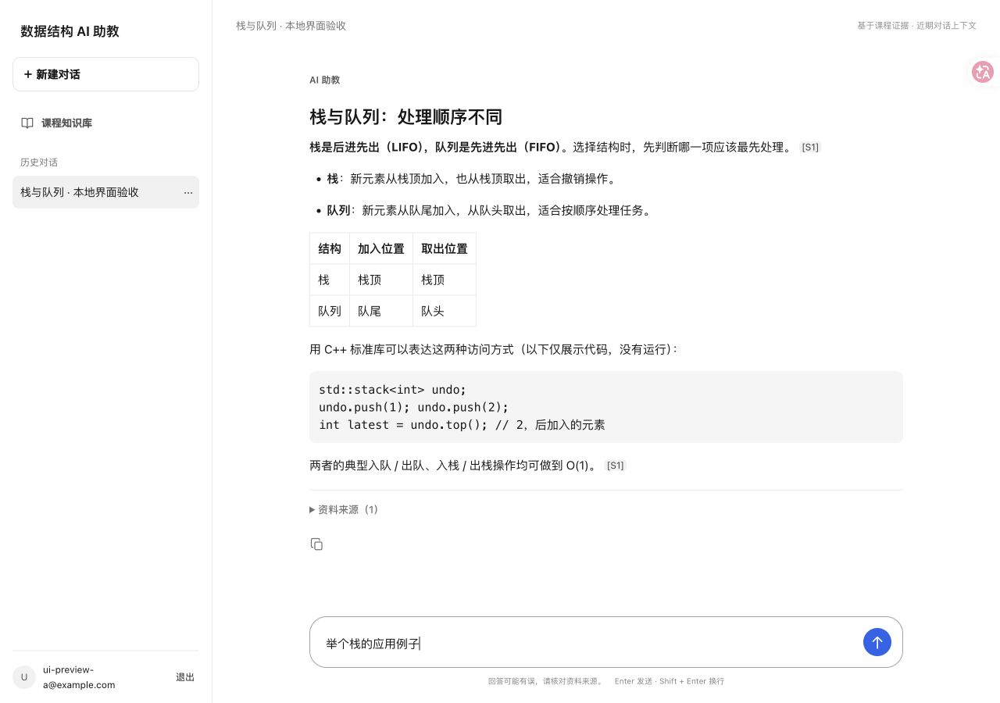
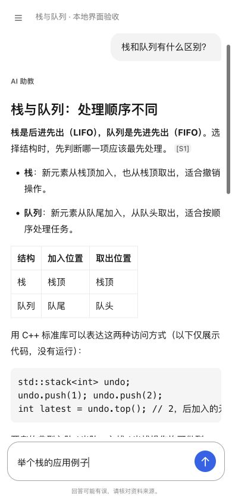
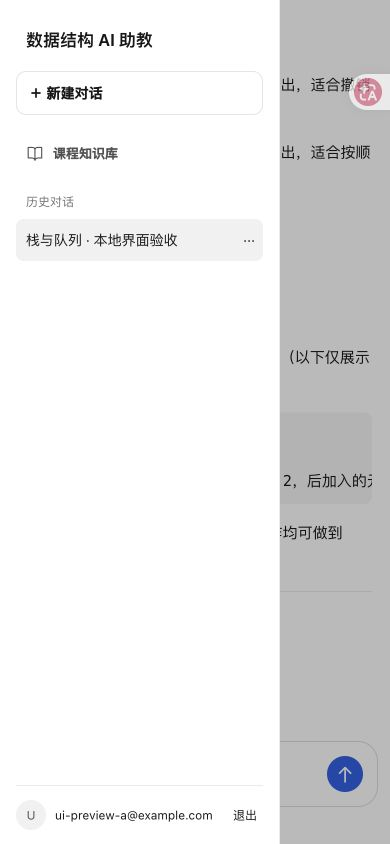

# 学生聊天界面简化与验收

基线为已合并的 `b5d8038`（`deploy/qwen-demo`），未带入 Draft PR #25。
前端改动不涉及后端业务、迁移、模型或课程向量；后续收尾补充了发布脚本的受控课程配置接入和部署测试。

## 课程库识别和发布前置条件

现有 KnowledgeBase API 只有资源 UUID、名称、描述及权限相关字段，没有稳定的课程用途/slug。
前端使用环境专用、非敏感的 `VITE_COURSE_KB_ID`：

1. 负责人在已授权账号的 `/api/v2/knowledge-bases` 列表中核实正式课程库。
2. 将其 UUID 配置为受控构建输入，或放入不提交 Git 的 `.env.production.local`；见
   [生产示例](../.env.production.example)。实际值不硬编码在应用源码，也不按名字猜测。
3. 只在当前登录用户的 API 列表中精确匹配。匹配成功后显示别名“课程知识库”并默认选择；
   其他库仍在服务器保留，学生界面不显示它们。此设置不授予任何后端访问权限。
4. 未配置、格式无效、无权限、资源缺失或重复匹配时，显示明确提示并禁止发送，绝不回退到 Synthetic。

**合并发布前必须完成服务器独立安装验收。** 发布脚本通过 `env -i` 构建前端，
本次收尾显式传入 `VITE_COURSE_KB_ID`，读取 root 受控文件并经课程导入清单及授权 HTTPS API 验证。
缺失、格式错误或无权访问时，在创建/切换 release 前失败。详见
[部署配置与独立安装说明](../../../deploy/v2/tencent/ci/README.md#正式课程库的构建配置)。
Git push 不会更新 checkout 外已安装的脚本，必须单独核对服务器安装证据后才能批准合并。
本地合成预览的 UUID 只在预览进程环境中传入，不能直接用于线上。

## 展示行为

- 移除“回答信息”，后端结果元数据仍保留在原响应/历史对象中，未清洗审计数据。
- 复制采用小型自绘 SVG；hover/focus 显示 Tooltip，成功显示勾号和“已复制”，失败明确提示。
  原生按钮支持键盘，移动端44px触点。只复制回答正文（包含原 Markdown/引用），不拼接来源卡片或调试信息。
  复制按钮位于回答正文下方、折叠资料来源上方；每条回复独立。
- 保留安全 Markdown、代码块/表格内部横向滚动、每条回答独立的折叠来源及引用定位。
- 侧栏顺序为项目名、新建、课程知识库、可滚动历史、账户和退出；没有多选计数、全选/清空。
- 课程不可用的原因同时显示在输入区上方，移动端无需展开抽屉即可看到；发送保持禁用。
- 新问题使用当前课程库；旧历史按原接口恢复，不改写历史来源范围。
  来自其他范围的待重试请求不会被静默改写为新库，需新建对话。
- 后端认证、CSRF、逐用途授权、Guard、会话持久化和幂等 API 保持原样。

## 验收边界

本地浏览器预览使用随机隔离 PostgreSQL 库、临时存储、两个合成账号和自编资料，
真实本地 API 完成认证和会话读写。Embedding 为确定性测试 Provider，回答为受控 Markdown 测试文本；
没有调用付费模型，也没有将这些截图当成线上 V1 课程或真实 Qwen 质量结果。
预览同时创建独立 Synthetic 库，验证它在 API 中存在而普通页面不显示。
测试结束只清理本轮随机库和临时存储，不删除线上 Synthetic 数据。

自动化命令：

```sh
npm run test
npm run build
test ! -e dist/mockServiceWorker.js
git diff --check
```

正式课程库 HTTPS 问答、部署版本和最终可用性须在配置审核、负责人合并及 Actions 发布后验收。
本轮不合并、不部署，原 `qa.dsassistant.cn` 与线上 release 保持不变。

## 本轮实际结果（2026-11-13）

| 项目 | 结果 |
| --- | --- |
| 完整 Vitest | PASS：94项，17个文件 |
| 生产构建 | PASS：类型检查、Vite构建通过；dist没有MSW Worker |
| 默认选库 / Synthetic隐藏 | PASS：页面只显示“课程知识库”，API仍保留两个库；全部问答请求的持久化范围为配置的课程库 |
| 复制 | PASS：鼠标hover和键盘focus显示Tooltip；Enter复制正文Markdown/代码/引用，点击后显示已复制；移动端44×44触点 |
| Markdown与来源 | PASS：粗体、列表、表格、C++代码；两条回复的[S1]仅展开对应来源且DOM ID不同；默认折叠 |
| 会话CRUD与恢复 | PASS：新建、切换、重命名、删除；刷新及重新登录恢复原4条消息 |
| 拒答 | PASS：unmatchedzzzzz显示资料不足，无虚构来源 |
| 权限与退出 | PASS：第二账号访问第一个账号课程库及会话404；无课程权限时禁止发送；退出204后读取会话401 |
| 1280×900桌面 | PASS：页面scrollWidth=1280，蓝色发送按钮为rgb(37,99,235)，没有回答信息区域 |
| 390×844移动视口 | PASS：scrollWidth=390，输入区底部=844，消息流位于输入区上方；抽屉顺序完整 |
| 线上真实课程 / 真实Qwen效果 | NOT RUN：本轮不部署、不改模型，不将本地受控回答当成真实模型质量 |

浏览器删除测试遇到原生confirm使自动化连接中断，恢复后从页面及API确认只删除了本轮测试对话，
原历史仍可恢复；未移除确认步骤。观察到一条浏览器扩展消息通道告警，核心页面交互正常。

以下为**本地自编合成资料和受控Markdown回答**，不是线上V1课程截图：




